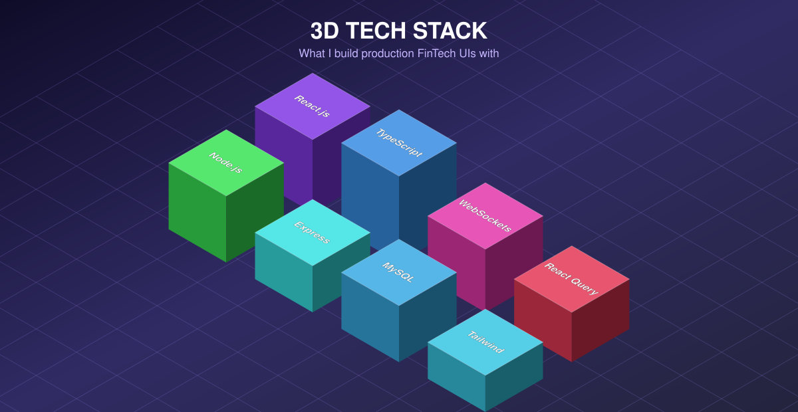

<div align="center">



[](https://git.io/typing-svg)

<p align="center">
  
  &nbsp;
  <a href="mailto:manikantachalasani08@gmail.com"></a>
  &nbsp;
  <a href="https://github.com/Manikantach03"></a>
</p>

</div>

---

## 🧑‍💻 About Me

Results-driven **Frontend Engineer** specializing in real-time trading platforms, with end-to-end ownership of multi-exchange crypto and multi-broker B2B equity systems from architecture to production. Deep expertise in **React.js, TypeScript, WebSocket-driven data streaming and high-frequency data visualization** — cutting UI latency by **~40%** and accelerating feature delivery by **~30%** through reusable component architecture.

```typescript
const manikanta: Developer = {
  name:       "Manikanta Chalasani",
  role:       "Frontend Developer",
  company:    "Havata Technologies",
  previously: "KrafIT Technologies (2024 – Mar 2026)",
  location:   "Hyderabad, Telangana, India 📍",
  experience: "2+ Years — Production FinTech & Trading Systems",
  education:  "B.Tech ECE — Dhanekula Institute of Engineering & Technology",

  expertise: [
    "Real-Time WebSocket Systems & High-Frequency Data Rendering",
    "Multi-Exchange Crypto Platforms (Binance, Delta, CoinDCX, Bybit, CoinSwitch)",
    "Multi-Broker Equity & F&O Platforms (Zerodha, Dhan, Shoonya, Jainam)",
    "Scalable B2B Frontend Architecture & Reusable Component Libraries",
    "TradingView-Style Charting & Options Chain Visualization",
  ],

  currentlyBuilding: "Full-Stack Retail & E-commerce Management Platform 🛒",
  motto:             "Building systems that move fast, scale big, and never break.",
};
```

---

## 🧊 3D Tech Stack



<p>
  
  
  
  
  
  
  
  
  
  
  
  
  
  
  
  
  
  
  
  
</p>

---

## 💼 Experience

| Role | Company | Period |
|---|---|---|
| **Frontend Developer** | Havata Technologies | 2026 – Present |
| **Frontend Developer** | KrafIT Technologies Pvt. Ltd. | 2024 – Mar 2026 |

---

## 🚀 Featured Projects

<details open>
<summary><h3>🛒 Retail & E-commerce Management Platform — Havata Technologies</h3></summary>

> `React.js` · `Node.js` · `Express.js` · `MySQL` · `Sequelize ORM` · `REST APIs` · `Tailwind CSS`

A **full-stack retail ERP** that connects inventory, barcode, sales & billing, purchasing and accounting in one system — eliminating duplicate data entry across business operations.

| Feature | Details |
|---|---|
| 📦 **Inventory & Barcode** | Variants, stock tracking, low-stock alerts, barcode generation/printing with category, model & date filters |
| 🧾 **Sales & Billing** | Invoices, payments, discounts, taxes, returns and sales reporting |
| 📒 **Built-in Accounting** | Double-entry bookkeeping, ledgers, journal vouchers, receivables/payables, trial balance, P&L, balance sheet |
| 🔐 **Role-Based Access** | Separate permissions for admins, managers and staff |
| 📊 **Reports & Export** | Date-range filters, printable reports, PDF/Excel export |

</details>

---

<details open>
<summary><h3>📈 NiyaCrypto — Multi-Exchange Crypto Trading Platform</h3></summary>

> `React.js` · `TypeScript` · `Tailwind CSS` · `WebSockets` · `Apache ECharts` · `amCharts`

A **production-grade** platform unifying **Binance, Delta Exchange, CoinDCX, CoinSwitch and Bybit** into a single real-time dashboard — no per-exchange logins for B2B operations.

| Feature | Details |
|---|---|
| ⚡ **Options Chain** | Sub-second WebSocket refresh with LTP, Open Interest & Greeks |
| 🤖 **Strategy Builder** | Rule-based entry/exit logic and conditional triggers for automated execution |
| 🚀 **Performance** | ~40% lower UI lag via `React.memo`, `useRef` and batched state updates |

</details>

---

<details open>
<summary><h3>💹 NiyamTrade — Multi-Broker B2B Equity & F&O Platform</h3></summary>

> `React.js` · `TypeScript` · `Tailwind CSS` · `WebSockets` · `React Query` · `Redux Toolkit`

A **scalable B2B trading platform** across **Dhan, Zerodha, Shoonya and Jainam** — centralized order execution over multiple broker accounts at once.

| Feature | Details |
|---|---|
| 🏦 **Trade Station** | Parallel multi-leg order execution across 5+ Indian brokers |
| 👥 **B2B Architecture** | Traders execute on behalf of mapped client accounts with JWT-secured sessions |
| ⚙️ **Risk Controls** | Lot-size limits and quantity caps with live position & order tracking |

</details>

---

## 🏆 What I Specialize In

| Domain | Expertise |
|---|---|
| ⚡ **Real-Time Systems** | WebSocket architecture, live data streaming, high-frequency rendering |
| 📈 **FinTech & Trading** | Crypto exchanges, equity/F&O platforms, Options Chain, P&L dashboards |
| 🏗️ **Scalable Architecture** | Reusable 40+ component library, service-layer API abstraction |
| 📊 **Data Visualization** | TradingView-style charts, candlesticks, real-time analytics |

---

## 🧊 3D Contribution Graph

<div align="center">

<!-- Generated daily by .github/workflows/profile-3d.yml (run it once manually after pushing) -->


</div>

---

## 🎖️ GitHub Achievements

<div align="center">

[](https://github.com/Manikantach03?achievement=yolo&tab=achievements)&nbsp;&nbsp;
[](https://github.com/Manikantach03?achievement=pull-shark&tab=achievements)

</div>

---

## ⚡ Fun Facts

- 🏦 I work where milliseconds matter — real-time trading systems where a 100ms lag costs real money
- 📡 I've built WebSocket pipelines that stream live market data from **5+ exchanges** at once
- 📈 Almost every `useEffect` I write has WebSocket data flowing through it

---

## 🤝 Connect With Me

<div align="center">

<a href="mailto:manikantachalasani08@gmail.com"></a>
&nbsp;
<a href="https://github.com/Manikantach03"></a>

| 📧 Email | 📱 Phone | 📍 Location |
|---|---|---|
| manikantachalasani08@gmail.com | +91 8688807103 | Hyderabad, Telangana, India |

</div>

---

<div align="center">


*"Building systems that move fast, scale big, and never break under pressure."*

</div>
