## 👋 About Me

Results-driven **Frontend Engineer** specializing in real-time trading platforms, with end-to-end ownership of multi-exchange crypto and multi-broker B2B equity systems from architecture to production. Deep expertise in **React.js, TypeScript, WebSocket-driven data streaming and high-frequency data visualization** — cutting UI latency by **~40%** and accelerating feature delivery by **~30%** through reusable component architecture.

- 💼 Frontend Developer at **Havata Technologies** (2026 – Present)
- 🏢 Previously **KrafIT Technologies** (2024 – Mar 2026)
- 📍 Hyderabad, Telangana, India
- 🎓 B.Tech ECE — Dhanekula Institute of Engineering & Technology

## 🤝 Connect With Me

📧 [manikantachalasani08@gmail.com](mailto:manikantachalasani08@gmail.com) &nbsp;·&nbsp; 📱 +91 8688807103 &nbsp;·&nbsp; 🐙 [GitHub](https://github.com/Manikantach03)

*"Building systems that move fast, scale big, and never break."*

